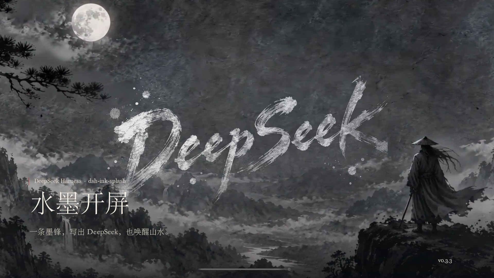
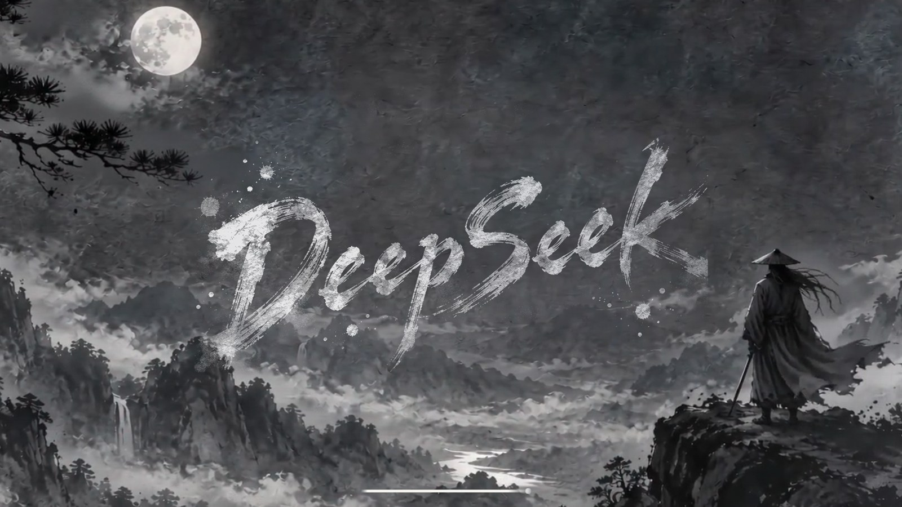
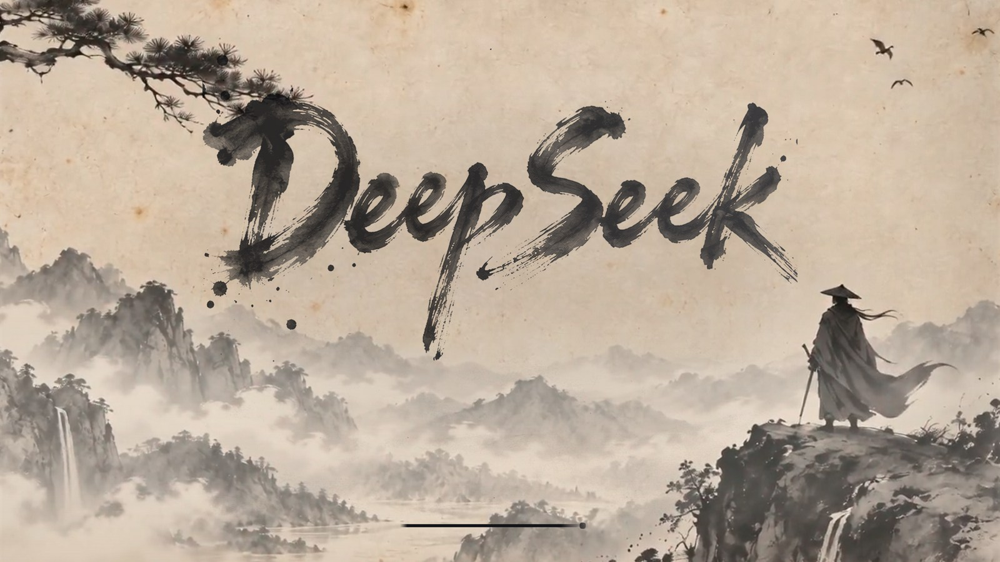

# dsh-ink-splash · 水墨开屏

> 为 DeepSeek Harness 打造的水墨开屏与配套主题：四段十秒成片，一条墨锋同时写出 DeepSeek 字标、唤醒背后的山水，并带上原片背景音。

四段十秒成片：**侠客 / 鲸娘 × 夜山 / 宣纸**。字标、运笔、落印、山水与配乐已经烘在同一条时间线上；设置只选画面与主题，开屏结束自动交棒给 DSH。

## 亮点

- **四段成片**：侠客深色、侠客浅色、鲸娘深色、鲸娘浅色各一段十秒影片，开屏不再是多层 CSS 拼出来的近似画面。
- **原片配乐**：四段影片自带背景音，开屏时随画面播放；不再额外合成一套替代音效。
- **缓存安全**：影片地址带 `album-v5` 版本键，替换素材不会继续命中旧的 immutable 缓存。
- **四档清晰度**：主题底图仍按 1600 / 1920 / 2560 / 3200 做 cover-aware 选档，不在小视口强行放大。
- **两套皮肤**：夜山、宣纸；画面（侠客 / 鲸鱼）× 主题（夜山 / 宣纸）两轴选择，四段成片一一对应。
- **只走合成层**：动画主体只改 transform / opacity，不使用全屏实时 blur/filter；`prefers-reduced-motion` 下隐藏新增纸帘。
- **右栏与对话流更顺**：右栏开合时，预模糊玻璃按面板自身可见边界裁剪，并跟随滑入同步展开；中间对话列不再对整列做实时 `backdrop-filter`，改用预模糊底图加轻 tint，宽度变化时不会出现边缘透明闪跳、重采样卡顿。
- **玻璃更干净**：主题玻璃使用 1600×914 预模糊图，左栏、窗口控制栏和主区顶角不再出现低分辨率放大的小方块；夜山模糊图已中性化，顶部不再偏绿。

## 预览

| 夜山 | 宣纸 |
| --- | --- |
|  |  |

## 安装

需要一个已能正常运行的 DSH 桌面版（0.2.x）。

1. 打开 DSH 侧栏「插件」页，点「添加插件」。
2. 任选一种来源填入对话框：
   - npm：`dsh-ink-splash@0.4.1`
   - Git：`https://github.com/xiaobaga281/dsh-ink-splash.git`
   - 源码目录的绝对路径；如果你本地已有发布包 `.tgz`，也可以直接填入包路径。
3. 确认安装；如果提示需要重启，重启 DSH。
4. 打开设置 → 开屏水墨，可以选画面、主题、壁纸亮度、重播时长，也可以点「重播」预览。

不要手工把解压目录放进 `%USERPROFILE%\.dsh\plugins\`，也不要在 profile 里自建 `node_modules` junction；这条旧路径会绕开官方插件管理器的依赖记录和版本检查。

## 设置

| 项目 | 可选值 |
| --- | --- |
| 主题 | 夜山 / 宣纸 |
| 画面 | 侠客 / 鲸鱼 |
| 其他 | 壁纸亮度、重播时长、重播预览 |

四段成片已经把字标、运笔、落印与配乐烘进影片，因此不再单独提供字标、运笔和声音档控件。

## 兼容性

- 仅桌面版 DSH（渲染进程使用 `dsh-app://app/`）。纯 Web 部署也可用，但开屏注入依赖 DSH 的 `webserver/index-inject` 钩子。
- 主题会改写 DSH 的一批 `--dsw-*` token；与其它改同一批 token 的主题插件不要同时启用。

## 版本

当前 **0.4.1**。完整变更记录见 [CHANGELOG.md](https://github.com/xiaobaga281/dsh-ink-splash/blob/main/CHANGELOG.md)。

0.4.1 把四段十秒成片改为 1440p / 60 fps / H.264 CRF15，保留原 AAC 背景音；影片名切到 `album-v5`，避免旧缓存继续播放 4K 原片，整包约 72.2 MiB。开屏动画完成这轮优化；右栏背景与对话区域背景的切入和切出也同步优化：玻璃底图按右栏可见边界裁开并跟随滑入，对话列改用预模糊底图加轻 tint，开合与窗口缩放更连续。

## 许可

MIT。主题曲 / 画面为随包资产，允许随本插件一起分发。
